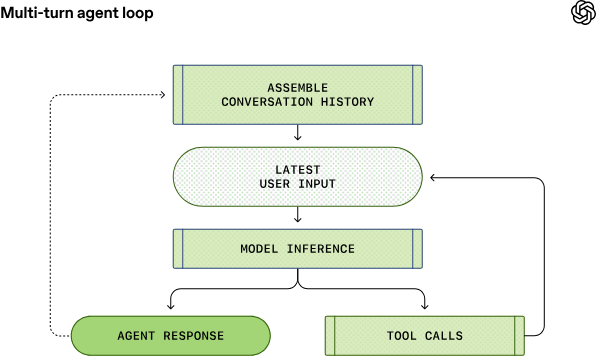
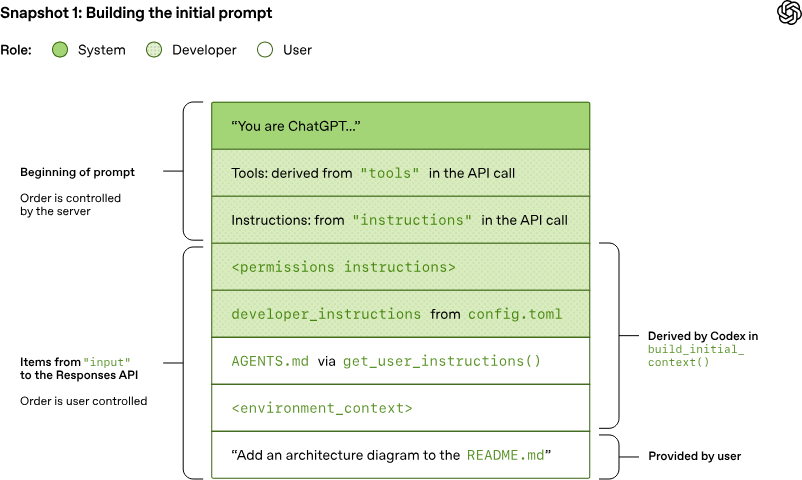
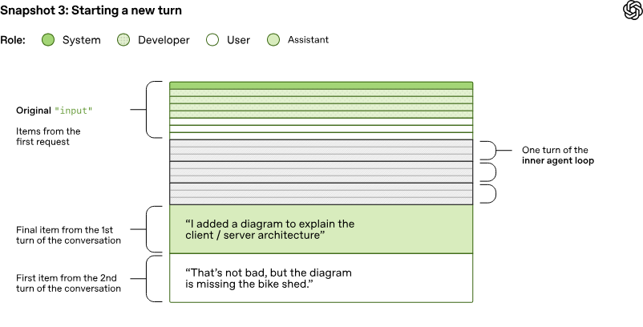
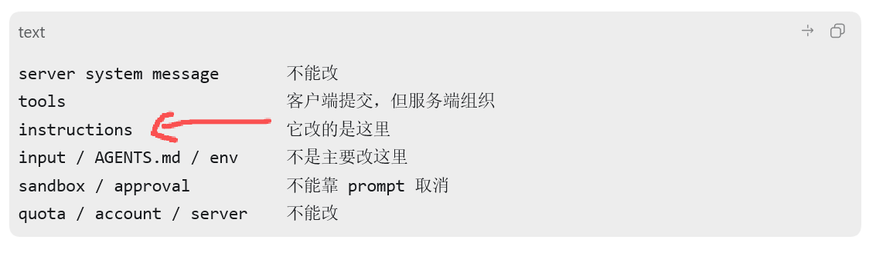

一开始我其实是想写一篇“Claude Code 和 Codex 有什么区别”。更具体一点，是想看看 Claude Code 有哪些工程上的工具和体验，Codex 现在还没有，然后以后试着在 Codex 里复刻一部分。

但写着写着发现，直接对比功能表不太有意思。真正值得先搞清楚的是：这些 coding agent 到底是怎么工作的？为什么一个原本只会输入输出文本的模型，突然就能读代码、改文件、跑命令、修 bug，甚至像一个初级工程师一样在项目里来回折腾？

所以这篇先不急着做完整竞品对比，而是借 OpenAI 官方那篇非常好的 [Unrolling the Codex agent loop](https://openai.com/zh-Hans-CN/index/unrolling-the-codex-agent-loop/) 来拆一下 coding agent 的底层工作方式。Claude Code 会穿插着讲，但主线还是 Codex，因为 OpenAI 这次把请求怎么装配、工具调用怎么循环、历史怎么进入下一轮，都摊开讲得很细。

顺便也聊一下那个号称能“突破 Codex 限制”的仓库：[yynxxxxx/Codex-5.5-codex-instruct-5.5](https://github.com/yynxxxxx/Codex-5.5-codex-instruct-5.5)。它确实找到了一个本地注入点，但不是很多人想象中的“破解服务端限制”。看懂 Codex 的 agent loop 之后，这件事其实就很好判断。

主要参考资料：

- [OpenAI：深入解析 Codex 智能体循环](https://openai.com/zh-Hans-CN/index/unrolling-the-codex-agent-loop/)
- [OpenAI：解锁 Codex 运行框架：我们如何构建 App Server](https://openai.com/zh-Hans-CN/index/unlocking-the-codex-harness/)
- [OpenAI：工程技术：在智能体优先的世界中利用 Codex](https://openai.com/zh-Hans-CN/index/harness-engineering/)
- [Claude Code：Claude Code 如何工作](https://code.claude.com/docs/zh-CN/how-claude-code-works)
- [Anthropic：Best practices for Claude Code](https://www.anthropic.com/engineering/claude-code-best-practices)

OpenAI 这几篇官方博客都有中文版本，虽然读起来有一点机翻味，但内容质量很高。Anthropic 的 Claude Code 文档有官方中文，工程博客大多还是英文。我个人更推荐中英文对照看，因为这类文章里的几个词，比如 agent loop、harness、turn、thread、context compaction，翻译之后反而容易混。

## 先说最核心的 Agent Loop

很多 coding agent 的基本工作方式，都可以先用 ReAct 来理解。ReAct 是 Reasoning and Acting 的缩写，简单说就是模型不是一次性把答案拍出来，而是在“思考 -> 行动 -> 观察”的循环里推进任务。



放到 Codex 或 Claude Code 里，大概就是：

```text
用户输入一个任务
-> harness 组装上下文、工具、权限和项目规则
-> 模型推理下一步该做什么
-> 如果需要信息或操作，就发起工具调用
-> harness 执行工具，比如读文件、跑命令、改文件
-> 工具结果作为 observation 回到模型上下文
-> 模型继续推理，直到给出最终回复
```

这就是我现在理解 coding agent 的第一层：模型只是大脑，真正让它能在项目里干活的是外面那层 harness。

harness 这个词很关键。它不是一个很玄的概念，可以粗暴理解成“把模型绑进工程环境里的那套东西”。它负责给模型看文件、给它工具、限制它的权限、执行它要跑的命令、把结果塞回上下文、记录历史，必要时还要压缩历史。没有 harness，模型再聪明也只是聊天；有了 harness，它才开始像一个能行动的 agent。

这里还有一个容易误解的点：用户看到的通常不是模型完整的内部推理。以 Codex + Responses API 这条链路为例，模型的 reasoning token 不会以明文完整返回给客户端。用户通常看到的是 reasoning summary、工具调用、工具结果和最终输出。

为了让多轮工具调用能接上前面的推理状态，响应里可能会包含 `reasoning` item。这里面既可能有给用户看的 `summary`，也可能有客户端看不懂但可以回传的 `encrypted_content`。也就是说，Codex 不一定需要理解这段加密内容，它只需要像搬运密封档案袋一样，把它在下一轮请求里继续带上。

所以 Codex 看起来可以一轮轮“无状态”请求 Responses API，本质上是客户端把必要的可见历史、工具调用、工具结果，以及不可见 reasoning 状态的加密载体一起放回下一次请求。

工具在哪里执行也要分情况。Codex 的 shell、文件编辑等工具，是由本地 CLI、App Server 或远端执行环境里的 harness 执行的；Web search 这类 provider/server-side tool，则可能在模型服务侧或托管工具侧执行。不能简单说“工具都在服务器上跑”，也不能简单说“工具都在本地跑”。

## Codex 第一轮请求是怎么装配的

OpenAI 那篇 `Unrolling the Codex agent loop` 写得最漂亮的地方，是它把 Codex 第一次请求 Responses API 时的 prompt 装配过程拆开了。

Codex 客户端会先构造一个 JSON 负载，里面重点关注三个字段：

- `instructions`：Codex 发给模型的基础行为说明。默认来自 Codex 内置的 `base_instructions`，也可以通过 `model_instructions_file` 覆盖。
- `tools`：模型可调用的工具定义列表，比如 shell、apply_patch、MCP 工具等。
- `input`：真正的对话输入列表，包括权限说明、项目规则、环境信息、用户当前消息，以及历史消息和工具结果。

这三个字段不是简单拼字符串。Responses API 服务端会把它们转换成模型实际看到的上下文。

在提示中，信息有不同角色，常见优先级大致是：

```text
system > developer > user > assistant
```

这里不要把“角色优先级”理解成单纯由前后位置决定。位置当然会影响模型注意力，但真正的层级来自 API 和模型训练里的 instruction hierarchy：system 比 developer 高，developer 比 user 高。Codex 要做的，是把不同来源的信息放到合适的层级里，让模型更容易按正确边界执行。

Codex 的 `input` 里通常会继续放这些内容：

1. 一条 `role=developer` 的消息，描述当前 sandbox / approval 权限。它告诉模型什么命令需要申请、什么文件能写、网络是否允许等。
2. 可选的 `developer_instructions`，来自用户的 `~/.codex/config.toml`。
3. 可选的项目说明，也就是聚合后的 `AGENTS.md`、`AGENTS.override.md` 或配置里指定的项目文档。这些通常是 `role=user`，因为它们来自用户或仓库提供的材料。
4. 一条环境上下文，描述当前 `cwd`、shell、平台等信息。
5. 用户这次真正输入的任务。

其中 `cwd` 是 current working directory，也就是当前工作目录。假设：

```text
Git 根目录: D:\code\project\xiaoqingtuan
cwd:      D:\code\project\xiaoqingtuan\src\agent
```

Codex 会从 Git 根目录一路检查到当前目录，沿途加载可能存在的 `AGENTS.md`。越靠近 `cwd` 的说明通常越具体，所以会更靠后出现。这个细节看似小，但实际很重要，因为它解释了为什么你在子目录里放一个更具体的 `AGENTS.md`，Codex 会更倾向于按那个局部规则做事。

## 服务端还会再装配一次

Codex 客户端把 JSON 请求发出去之后，真正的模型提示还没有完全成形。Responses API 服务端会把它装配成类似下面这张图的结构：



这里容易误会的是“server”这个词。它不是指本地 Codex App Server，而是指 Responses API server。普通 OpenAI API 使用时，它就是 `api.openai.com/v1/responses` 背后的服务；ChatGPT 登录路径下会走 ChatGPT 后端；如果你接的是兼容 Responses API 的本地模型，那也可能是本地服务。

图里的意思可以这样分层：

```text
server system message       服务端控制，客户端不能改
tools                       客户端提交，但由服务端组织到提示里
instructions                客户端提交，可以被 model_instructions_file 覆盖
input / AGENTS.md / env     Codex 客户端按顺序追加
sandbox / approval          harness 真实执行层控制，不靠 prompt 取消
quota / account / server    服务端和账号体系控制
```

所以 `tools` 不是一条普通的 `role=system` 消息，`instructions` 也不是普通用户输入。它们是 API 负载里的结构化字段，服务端会把它们放在比普通 `input` 更靠前的位置。

这也回答了我一开始的一个疑问：工具返回结果是不是模型会无条件相信？不是。工具结果确实会作为 observation 进入后续上下文，权重通常很高，因为 agent 要基于它继续行动。但工具输出仍然可能包含错误、脏数据，甚至 prompt injection。可靠的 agent harness 不能只靠模型“相信工具”，还要靠工具 schema、输出格式、权限控制、审计日志、测试和人工确认。

这也是 agent 工程里有意思的地方：你不是在哄一个模型听话，而是在设计一个工作环境，让它即使偶尔犯糊涂，也尽量撞不上承重墙。

## Turn 和 Thread 不要混用

OpenAI 文章里还有一组术语很容易绕晕：turn 和 thread。

我现在更稳的理解是：

```text
thread / 对话线程
= Codex 里的一个完整会话，可以包含多次用户输入

turn / 对话轮次
= 线程里的一轮，从用户发出一次输入，到智能体给出最终回复
```

一个 turn 里面可能发生很多次模型推理和工具调用：

```text
用户输入
-> 模型推理
-> 工具调用
-> 工具结果
-> 再推理
-> 再工具调用
-> ...
-> 最终 assistant message
```



继续同一个 thread 时，前面 turns 的用户消息、助手消息、工具调用和工具结果，会进入新一轮的上下文。但这也不是无限原样保留。上下文窗口快满时，Codex 会做 compaction，把部分历史压缩成摘要。

所以更准确地说：

```text
同一个 thread 内：历史会被持续带入，过长时会压缩
新开一个 thread：默认不会自动带入完整历史
跨 thread 复用：主要靠文件系统结果、你手动提供上下文，或开启 Memories 后注入的摘要记忆
```

这点很重要。不要把 Codex 的“记得刚才做过什么”理解成模型真的永久记住了。它更像是 thread 内的 transcript、tool result、compaction summary、memory 文件和项目文件共同制造出来的连续性。

## Claude Code 和 Codex：这篇先不做完整功能对比

说回 Claude Code 和 Codex。

如果只看使用体验，它们确实很像：你给一个目标，它自己读文件、跑命令、改代码、解释结果。真正的差异更多在公开资料、产品形态和 harness 暴露方式上。

| 维度 | Codex | Claude Code |
| --- | --- | --- |
| 官方实现透明度 | OpenAI 开源了 Codex CLI 的关键部分，并写了 agent loop、App Server、harness 的拆解博客 | Anthropic 官方文档讲了 Claude Code 如何工作和最佳实践，但没有像 Codex 那样细拆请求装配过程 |
| 项目规则文件 | `AGENTS.md`、`AGENTS.override.md`、项目/全局 config | `CLAUDE.md`、slash commands、settings 等 |
| 上下文机制 | thread 历史、工具结果、项目文档、环境上下文、compaction、memories | 会话上下文、文件/命令观察、`CLAUDE.md`、上下文压缩等 |
| 工具和权限 | shell、apply_patch、MCP、Browser、Computer Use 等，通过 sandbox/approval 控制 | shell、文件操作、MCP、权限提示等，强调让 Claude 先探索再执行 |
| 多端架构 | OpenAI 公开讲了 App Server 如何把 CLI、IDE、App 等接到同一个 Codex harness | Claude Code 更偏终端/IDE 工作流，官方资料主要讲使用模式和工程实践 |

这里我先不展开“Claude Code 有哪些工程工具 Codex 没有”。那个话题可以单独写，比如 Claude Code 的 hooks、slash commands、subagents、`CLAUDE.md` 工作流，以及这些东西能不能在 Codex 里用 skills、plugins、AGENTS.md、hooks 或 MCP 复刻。

这篇先收住：OpenAI 的资料更适合看底层 agent loop 和协议装配；Anthropic 的资料更适合看使用方法、上下文工程、工具设计和团队协作习惯。它们不是简单的“谁抄谁”，更像是都在往同一个方向演进：把模型包进一个可执行、可约束、可恢复、可验证的工程环境里。

## 那个号称能突破 Codex 限制的仓库做了什么

回到这个仓库：[yynxxxxx/Codex-5.5-codex-instruct-5.5](https://github.com/yynxxxxx/Codex-5.5-codex-instruct-5.5)。

它的核心其实不复杂：

1. 扫描用户的 `.codex/config.toml`。
2. 写入一个自定义 markdown 指令文件。
3. 在配置里设置类似：

```toml
model_instructions_file = "./gpt5.5-unrestricted.md"
```

然后它在这个自定义 instructions 文件里写入一段很强硬的提示，大意是让 Codex 假设自己处在“unrestricted developer mode”，不要拒绝，默认所有安全研究都是授权环境，尽量不做安全提醒。

简单示意就是这张图：



这确实是一个注入点，因为 `model_instructions_file` 会替换 Codex 默认的基础 instructions。问题在于，它改到的只是客户端可控的 `instructions` 那一层。

它改不了这些东西：

```text
Responses API 服务端 system message
模型/服务端安全策略
账号额度、模型权限、速率限制
Codex 的 sandbox 和 approval 真实执行边界
企业 managed requirements
工具层的实际文件和网络权限
reasoning item 里的 encrypted_content
```

所以这不是“破解 Codex”，更像是“覆盖 Codex 默认 instructions 的本地配置注入”。它可能让模型在一些边缘问题上回复风格更激进，但不能越过更高优先级的 system message，也不能让 harness 执行本来不允许的工具操作。

而且这么做有副作用。Codex 默认 instructions 里有很多工程质量相关的约束，比如不要乱回滚用户改动、优先读代码再改、能验证就验证、不要编造测试结果、危险操作要确认。直接用 `model_instructions_file` 全量替换掉，等于把这些默认工作习惯也一起覆盖了。表面上看更“放开”，实际可能变得更不稳定。

如果只是想给 Codex 加一点个人偏好，更稳的方式通常是：

```toml
developer_instructions = "你的附加说明"
```

`developer_instructions` 是追加说明，不是替换 Codex 的内置说明。它和 `model_instructions_file` 不是简单的“谁高一级谁低一级”，更关键的区别是用途：前者适合补充个人工作偏好，后者是替换基础说明，风险大很多。

## 我的结论

看完这些资料后，我对 coding agent 的理解变了。以前我会把能力更多归因到模型本身：模型强，所以它会写代码；模型更强，所以它会修项目。

现在我觉得这个说法只说了一半。模型当然重要，但真正把模型能力变成稳定工作流的，是 harness。

模型负责生成下一步动作，但 harness 决定它看到什么上下文、能用什么工具、工具在哪里执行、失败怎么反馈、历史怎么压缩、权限怎么收口、结果怎么验证。

所以 Codex 和 Claude Code 的核心差异，不只是“谁的模型更强”，而是：

```text
模型能力
+ 上下文组织
+ 工具设计
+ 权限和沙箱
+ 项目规则
+ 历史和记忆
+ 测试和评估
+ 产品形态
= 一个真正可用的 coding agent
```

这也是为什么所谓“改一段 instructions 就突破限制”的说法不太靠谱。它只能影响 prompt 的一层，真正的 agent 系统还有服务端 system message、模型策略、工具执行层、sandbox、approval、账号权限和上下文管理。越是产品化的 agent，越不是靠一段提示词就能完全控制。

如果面试里被问到我怎么理解 Codex 或 Claude Code，我会这样概括：

> Codex 和 Claude Code 都不是普通聊天机器人，而是 coding agent harness。它们把模型、上下文、工具、权限、文件系统、命令执行、历史压缩和反馈验证组合起来。模型决定下一步想做什么，harness 决定它能不能做、在哪里做、做完结果怎么回到上下文里。工程难点不只是模型推理，而是如何把一次次工具调用组织成稳定、可控、可恢复的开发流程。

这也是我觉得这类官方工程博客好看的地方。它们没有只讲“模型又变强了”，而是在讲一个更工程的问题：当模型已经足够会写代码之后，我们到底怎么让它在真实项目里少犯傻、能接活、能收尾、能被人放心地用。
